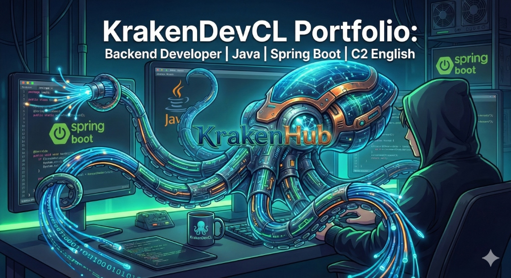

<div align="center">
  
  
  # 🌊 KrakenDevCL Portfolio
  
  ### Desarrollador de Software (Backend & Low-Code)
  
  [](https://krakendev-portfolio.vercel.app/)
  [](https://www.linkedin.com/in/krakendevcl/)
  [](mailto:krakendev.cl@gmail.com)

  *Backend Developer apasionado por la escalabilidad y la versatilidad técnica.*
</div>

---

## 🚀 Sobre el Proyecto

Este portafolio no es solo una vitrina de proyectos; es una aplicación moderna construida con **Next.js 15**, **React 19** y **Tailwind CSS**. Está diseñado para ofrecer una experiencia de usuario fluida y demostrar mis capacidades técnicas tanto en el frontend como en la arquitectura de sistemas.

### 🛠️ Tech Stack Principal

<div align="center">
  
  
  
  
  
  
</div >

---

## ✨ Características Destacadas

### 🤖 Integraciones con IA
- **Chatbot Asistente**: Responde preguntas sobre mi experiencia y proyectos. Utiliza Google Gemini cuando está configurado y respuestas basadas en el perfil cuando no está disponible.
- **Generador de Introducciones**: Herramienta que utiliza IA para redactar mensajes de presentación personalizados basados en el perfil del empleador.

### 🔍 Optimización SEO (Vercel Ready)
- **Rastreo Óptimo**: `robots.txt` y `sitemap.xml` dinámico para una indexación perfecta en Google Search.
- **Social Metadata**: Configuración completa de **Open Graph** y **Twitter Cards**.
- **Rich Snippets**: Implementación de **JSON-LD (Schema.org)** para resultados enriquecidos de Persona y Sitio Web.

---

## 📁 Proyectos Principales

- **Ingeniería asistida por IA**: caso de estudio con evidencia, validación documental y revisión humana.
- **[Agente híbrido de IA](https://github.com/KrakenDevCL/taller-inmersion-agentes-ia-llm-rag)**: notebook de aprendizaje con LangGraph, FAISS, Gemini y búsqueda web.

- **[Tentáculo App](https://tentaculo-app-portfolio.vercel.app/)**: Clon frontend de aplicación financiera interactiva con datos simulados (React / Vite / Spring Boot / Java).
- **[KrakenHub API](https://github.com/KrakenDevCL/KrakenHub-API)**: Red social para desarrolladores (Spring Boot / Security / JPA).
- **[KrakenHub Frontend](https://github.com/KrakenDevCL/KrakenHub-Frontend)**: Frontend para red social de desarrolladores (Next.js / React / Tailwind CSS).
- **[Voll.med API](https://github.com/KrakenDevCL/vollmed-api)**: Gestión clínica completa con seguridad JWT y Flyway.
- **[Literalura](https://github.com/KrakenDevCL/literalura)**: Catálogo de libros integrando APIs externas (Spring Boot / PostgreSQL).
- **[Portafolio KrakenDevCL](https://github.com/KrakenDevCL/krakendev-portfolio)**: Este sitio web personal interactivo (Next.js / Tailwind CSS / Genkit).

La metodología pendiente para comparar corridas está en [evaluación del proyecto de IA](docs/evaluacion-proyecto-ia.md). El [guion de presentación](docs/guion-presentacion.md) utiliza únicamente demostraciones ficticias.

---

## ⚙️ Instalación Local

### Vista local del caso de estudio

Con las dependencias instaladas, ejecuta `npm run dev -- --hostname 127.0.0.1`.
El portafolio estará en <http://localhost:9002> y el caso de estudio en
<http://localhost:9002/proyectos/ingenieria-asistida-ia>.
La versión inglesa está en <http://localhost:9002/en>; los CV imprimibles están
en `/cv` y `/en/cv`. Los cambios de idioma también están disponibles desde el sitio.

El caso incluye una demostración interactiva de trazabilidad y un documento HTML
descargable de dos páginas con datos ficticios. Ejecuta `npm run demo:build` para
regenerarlo y `npm run demo:test` para verificar el comprobador de citas.

El [agente híbrido](http://localhost:9002/proyectos/agente-hibrido) incluye una
demo reproducible de búsqueda local con datos ficticios; `npm run agent-demo:test`
comprueba recuperación y preguntas sin respuesta. La búsqueda local no usa credenciales,
un LLM, FAISS ni búsquedas reales. Opcionalmente, el botón «Preguntar con Gemini»
envía la pregunta y una fuente ficticia a Google para generar una respuesta con
su clave configurada. No utiliza LangGraph ni FAISS. El CV actualizado está en
`/cv` y se puede imprimir a PDF.
La versión autónoma descargable se regenera con `npm run agent-demo:build` desde
el mismo código que usa el sitio y funciona sin servidor ni conexión.

La demo independiente de terminal con LangGraph y FAISS está en
[`examples/agent-rag`](examples/agent-rag/README.md). Es una demostración nueva
con datos ficticios, separada del notebook original y de la demo web simplificada.

El caso reconoce la autoría de José Antonio Gallegos Carvallo y utiliza un ejemplo
ficticio. Para futuras ediciones, conservar nombres genéricos y material creado
para el portafolio; no incorporar código, capturas, documentos ni identificadores
de sistemas internos. El texto público de referencia está en
[docs/ingenieria-asistida-ia.md](docs/ingenieria-asistida-ia.md).

La navegación local no requiere claves de servicios. El formulario de contacto
requiere `RESEND_API_KEY`, `CONTACT_EMAIL_RECIPIENT` y `RESEND_FROM_EMAIL`. El chatbot funciona con
respuestas de respaldo sin credenciales; para respuestas de Gemini requiere una clave
de Google GenAI. Configura las claves solo en un archivo `.env.local` ignorado por Git.

### Preparación para producción

1. Verificar con `npm run typecheck`, `npm run demo:test`, `npm run agent-demo:test` y `npm run build`.
2. Configurar `GEMINI_API_KEY` como variable secreta del entorno del hosting. Si se habilita el formulario, configurar también `RESEND_API_KEY`, `CONTACT_EMAIL_RECIPIENT` y `RESEND_FROM_EMAIL` con un remitente verificado en Resend.
3. Sustituir cualquier clave compartida en una conversación por una nueva y revocar la anterior desde el proveedor. No subir archivos `.env` ni valores de credenciales al repositorio.
4. Revisar en una vista previa los enlaces, el CV, el chatbot y el formulario sin enviar mensajes reales de prueba a terceros. Confirmar después el dominio y las variables del entorno que se usará.

El chatbot envía las preguntas y los fragmentos públicos seleccionados al proveedor
de IA cuando está configurado. El sitio indica a sus visitantes que eviten compartir
información sensible. El comportamiento de respaldo funciona sin el proveedor.

Si deseas probar el proyecto en tu máquina:

1. **Clona el repositorio**:
   ```bash
   git clone https://github.com/KrakenDevCL/krakendev-portfolio
   ```

2. **Instala las dependencias**:
   ```bash
   npm install
   ```

3. **Variables de Entorno**:
   Configura tu archivo `.env` con las API keys de Google GenAI y Resend.

4. **Inicia el servidor**:
   ```bash
   npm run dev
   ```

---

<div align="center">
  Desarrollado por <b>KrakenDevCL</b>
</div>
